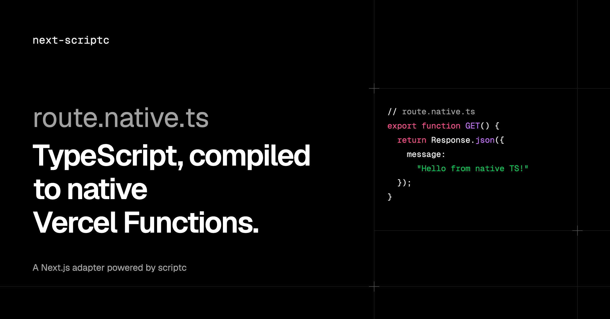
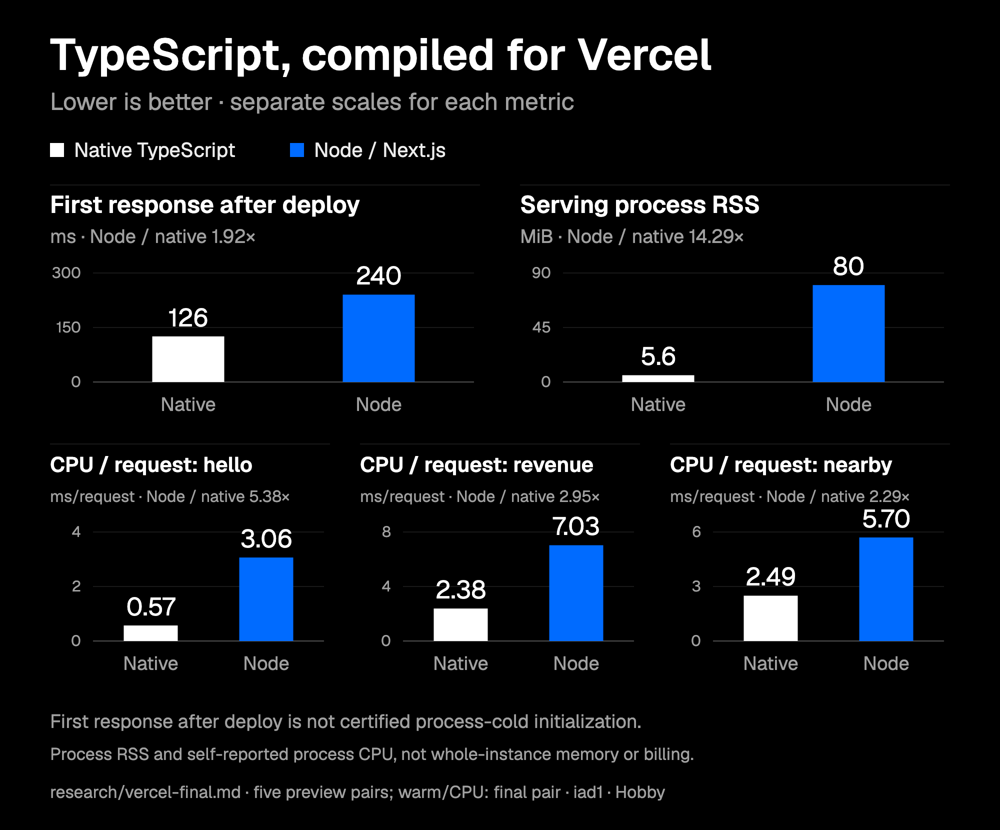
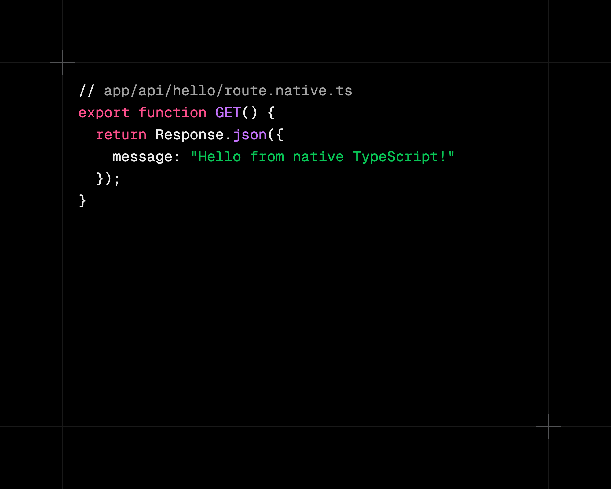

# next-scriptc

Compile Next.js `route.native.ts` handlers and `"use native"` functions to native executables with [scriptc](https://github.com/vercel-labs/scriptc), without a Next.js fork, with native-route deployment to Vercel Functions.



[Try it](#quickstart) · [Limits](#supported-surface-and-limits) · [Where Go still wins](#where-go-still-wins)

## Results on Vercel

| Measurement | Native TypeScript | Go SIMD | Go | Node | Evidence |
| --- | ---: | ---: | ---: | ---: | --- |
| Vector search, server compute p50 | **10.0 ms** (patched) | 14.2 ms | 50.0 ms | 108.6 ms | [Vector route](research/vector-vercel.md#measurements) |
| First hello after deploy, median | **126 ms** | | | 240 ms | [Five preview pairs](research/vercel-final.md#deployment-first-latency) |
| Process RSS after first hello | **5.6 MiB** | | | about 80 MiB | [Serving-process memory](research/vercel-final.md#process-memory) |
| Hello CPU/request, median | **0.570 ms** | | | 3.064 ms | [Process CPU](research/vercel-final.md#process-cpu-per-request-self-reported) |
| Revenue CPU/request, median | **2.384 ms** | | | 7.029 ms | [Process CPU](research/vercel-final.md#process-cpu-per-request-self-reported) |

<p>
  
  
</p>

The vector route searches 100,000 × 768 int8 values for exact top-10 results: 120 warm C=1 requests per variant across three fresh preview sets in iad1. Every response matched; deployed AVX2 dispatch was verified. **10.0 ms requires the compiler-fork patch**; stock scriptc 0.4.6 reaches **10.1 ms with `Math.imul`**, while unmodified natural multiplication takes **408.9 ms**. Go SIMD uses experimental `simd/archsimd`. This compares Go implementations packaged as Functions, not Next's `route.go` prototype. [Method and limits](research/vector-vercel.md).

The hello/revenue experiment used Next 16.4.3, scriptc 0.4.6 and a Hobby account in iad1. First-after-deploy is end-to-end latency, not certified process-cold initialization. RSS covers the serving process, excluding separate platform processes; CPU is self-reported process CPU, not Vercel billed Active CPU. Neither experiment establishes production capacity or whole-instance efficiency. [Full report](research/vercel-final.md).

**Losses:** Markdown rendering with `marked` used **40.209 vs 4.593 ms CPU/request** and **60.620 vs 24.329 ms warm C=1 p50**, native versus Node. Native vector initialization and short concurrent WAN tails also lost to Go SIMD. [Markdown evidence](research/vercel-final.md#process-cpu-per-request-self-reported), [vector losses](research/vector-vercel.md#losses-and-limits-on-the-win).



## Quickstart

Use Node 24, pnpm 11.1.3 and macOS or Linux with a native linker ([toolchain notes](examples/demo/README.md#compiler-installation)). The package is experimental, version `0.0.0`, and **is not published on npm**. In an existing Next 16.4.3 TypeScript app:

```sh
pnpm add "github:nebler/next-scriptc#path:/packages/next-scriptc"
pnpm approve-builds scriptc
pnpm rebuild scriptc  # initialize bundled compiler helpers
```

Keep optional dependencies enabled. The [pnpm Git subdirectory syntax](https://pnpm.io/11.x/package-sources#install-from-a-subdirectory-of-a-git-repository) selects the adapter package, not the repository root. Commit your lockfile to retain the resolved Git revision. A packed copy was tested in a separate Next 16.4.3 app with a strict tsconfig: install, `next build`, `next start`, a native HTTP response and native function prerendering.

Enable the adapter in `next.config.ts`:

```ts
import type { NextConfig } from "next";
import { withScriptc } from "next-scriptc";

const config: NextConfig = {};
export default withScriptc(config);
```

Create `app/api/hello/route.native.ts`:

```ts
export async function GET(request: Request) {
  const name = new URL(request.url).searchParams.get("name") ?? "world";
  return Response.json({ message: `Hello, ${name}` });
}
```

Ordinary `route.ts` handlers stay on Node. Development executes the native route's TypeScript on Node too; compilation happens during `next build`.

Build and run your app:

```sh
pnpm exec next build
pnpm exec next start
# GET /api/hello?name=world returns {"message":"Hello, world"}
```

Or clone this repository and try the demo:

```sh
git clone https://github.com/nebler/next-scriptc.git
cd next-scriptc
pnpm install --frozen-lockfile
pnpm --filter demo dev
```

Plain `next start` owns native startup, readiness, crash restart and cleanup. `next-scriptc start` is a compatibility alias. The [demo README](examples/demo/README.md) covers grouping, the Node baseline and compiler overrides.

For Vercel, run from the app directory with an authenticated Vercel CLI on `PATH` and a linked project (`vercel link`, then `vercel pull --environment=preview`):

```sh
pnpm exec next-scriptc vercel-build
vercel deploy --prebuilt
```

`vercel-build` runs `vercel build` with Vercel's Next adapter enabled, then replaces native route outputs with Linux x86-64 executable Functions. It accepts only `--prod`; production builds and prebuilt deploys must both use that flag. Function-level `"use native"` is **not supported on Vercel yet**; those functions run on Node there. The demo's separate [Vercel benchmark tooling](examples/demo/bench/vercel/README.md) adds grouping and resource controls for its larger route set.

## Native functions

For a smaller compute boundary, mark a named module-level async function:

```ts
// lib/totals.ts
export async function total(values: number[]): Promise<number> {
  "use native";
  return values.reduce((sum, value) => sum + value, 0);
}
```

Call it with `await total(values)` from a Server Component, Server Action or route handler. A file-level `"use native"` selects all named exported async functions. In production the call crosses a strict JSON boundary into a native process. Small calls can cost more than they save: the revenue dashboard's observed Linux crossover was **between 5,000 and 15,000 rows**, with native winning at 15,000. This is a single shared-host measurement, with overlapping tails, not a universal threshold. [Function-level results](research/function-level.md#review-round-3-measurements-after).

## How it works

The adapter uses Next's `adapterPath`, `modifyConfig` and `onBuildComplete` hooks. It discovers native routes, generates typed entries and compiles them with scriptc. Next retains prerendered route output.

```text
Development:  Next -> original TypeScript on Node
Self-hosted:  Next -> loopback HTTP -> supervised native route process
              Node function stub -> JSON over loopback HTTP -> native functions
Vercel:       Vercel's Next adapter -> executable Function -> native HTTP + IPC
```

Routes default to one native process each. Explicit groups share a process, module state, event loop and failure domain. Self-hosted requests still pass through Next; native process RSS alone excludes that frontend. On Vercel the executable handles HTTP and platform IPC in one process. [Adapter notes](research/adapter-notes.md).

## Supported surface and limits

- App Router `route.native.ts` on macOS/Linux; dynamic and catch-all params, methods, Web Request/Response and a subset of `next/server`. See the [shim contract](packages/next-scriptc/shim/README.md) for the exact surface.
- Named async `"use native"` functions with JSON parameters/results. No optional or `undefined` slots, `any`, `unknown`, bigint, classes, accessors, functions, cycles, sparse arrays or non-finite numbers. Use required `| null` fields for absence. Type checks and runtime validation enforce different parts of this contract.
- Function extraction rejects component closures, React/Next dependencies, JSX, browser/Edge imports, dynamic imports and unsupported globals. It does not transfer Node identity, shared mutable state, request context or framework caches. [Full constraints](research/function-level.md#extraction-and-constraints).
- Compiler errors fail native builds. npm compatibility depends on scriptc: Zod's real async route integration refused **SC1016** despite standalone success; `@upstash/redis` compiled but refused **SC1090** at native startup. The I/O example uses Valibot and Redis REST fetch on both runtimes. [Library outcomes](research/realistic-io.md#library-and-compiler-outcomes).
- Native routes implement a request bridge, not full Next framework semantics. No framework caching or complete NextURL/middleware API; uploads are buffered, response streaming lacks transport backpressure, and client cancellation does not propagate to the handler's AbortSignal. Configured native routes/functions reject `output: "standalone"` and static export. [Shim limits](packages/next-scriptc/shim/README.md).
- Self-hosted ports are derived from the project path. Replicas need separate port namespaces. All native functions share one event loop; CPU work can block sibling calls.

The [realistic I/O experiment](research/realistic-io.md) includes authenticated orders, validation, Redis and signed payment webhooks. Hosted GET-orders C=1 p50 was **24.774 vs 26.455 ms**, native versus Node; POST p99 was worse at **205.148 vs 51.649 ms**. All three pairs' latency windows completed, but one CPU cell remains unavailable. Local emulated I/O had additional native losses. Network-bound work is not a general speedup claim.

## Where Go still wins

The [three-way route experiment](research/go-territory.md) found clear Go wins for CSV and bcrypt. At self-hosted C=1, 100,000-row CSV p50 was **86.287 ms Go, 377.395 ms native TypeScript and 618.074 ms Node**. Cost-10 bcrypt was **70.598 ms Go vs 12,829.048 ms native**, with only three measured requests; native C=16 hit Next's proxy timeout. That is `bcryptjs` versus Go's bcrypt implementation, not identical machine code.

Go also won the raw RGBA thumbnail route locally and image resizing in the [kernel scouting results](research/scouting-summary.md); its popcount intrinsic won binary-embedding search. Other cases differ: Go lost the self-hosted JSON transform on latency and CPU. Kernel-only Linux scouts are not hosted route benchmarks. Hosted Go comparisons used a separate completion run and a different generator size, so their ratios are descriptive, not one uninterrupted controlled three-way run.

The route also has losses: the first response after deploy was 1.09 to 1.40 s for native versus 0.34 to 0.42 s for Go SIMD, mostly slower synthetic corpus generation, and a short C=4 window had a worse WAN p95 for native (916 vs 637 ms). The load client ran outside iad1, so end-to-end latency is reported only as secondary data. [Method, raw data and limits](research/vector-vercel.md).

## Status

Experimental. Tested with Next 16.4.3 and pinned scriptc 0.4.6. The [int8 range-analysis patch](research/scriptc-int8-range-analysis.md) lives in a scriptc fork; full upstream validation is still running and has not been reported as passed. Compatibility depends on scriptc's supported TypeScript, libraries and runtime packs, plus Next's adapter contracts and Vercel's executable IPC protocol. This is an adapter experiment, not a production compatibility guarantee.

## Tests

[](https://github.com/nebler/next-scriptc/actions/workflows/ci.yml)

CI runs compiler-free unit and benchmark-harness tests on Ubuntu with Node 24 and pnpm 11.1.3. **The maintainer must verify the first GitHub Actions run after pushing this workflow.** Native compilation and shim parity remain local checks.

With Node 24 on `PATH`:

```sh
pnpm install --frozen-lockfile
pnpm test  # compiler-free package tests and offline demo harness
```

With scriptc's native helpers and the platform linker installed:

```sh
SCRIPTC_CHECKER_SERVER=0 pnpm --filter next-scriptc test
SCRIPTC_CHECKER_SERVER=0 pnpm --filter next-scriptc test:shim
pnpm --filter demo test
SCRIPTC_CHECKER_SERVER=0 node examples/demo/test/functions.mjs
SCRIPTC_CHECKER_SERVER=0 node examples/demo/test/function-build.mjs
SCRIPTC_CHECKER_SERVER=0 node examples/demo/test/e2e.mjs
SCRIPTC_CHECKER_SERVER=0 node examples/demo/test/routes.mjs
```

The integration runners build and launch local Next/native servers; run them sequentially. See [installation notes](examples/demo/README.md#compiler-installation) for scriptc helper permissions on fresh installs.

## Benchmarks

- [Vector search on Vercel](research/vector-vercel.md): native TypeScript versus Go SIMD, plain Go and Node, with patch/stock controls and losses.
- [Final Vercel comparison](research/vercel-final.md): deployment-first latency, warm requests, CPU, memory, sizes and failures.
- [Realistic I/O](research/realistic-io.md): Redis-backed orders and webhooks, hosted and local.
- [Function-level native code](research/function-level.md): JSON boundary costs and dashboard crossover.
- [Go territory](research/go-territory.md): CSV, JSON, raw thumbnails and bcrypt.
- [Scouting summary](research/scouting-summary.md): kernel candidates, wins and losses.
- [Benchmark protocol and history](research/benchmarks.md), [research index](research/README.md).

## License

[Apache-2.0](LICENSE), copyright next-scriptc contributors.
