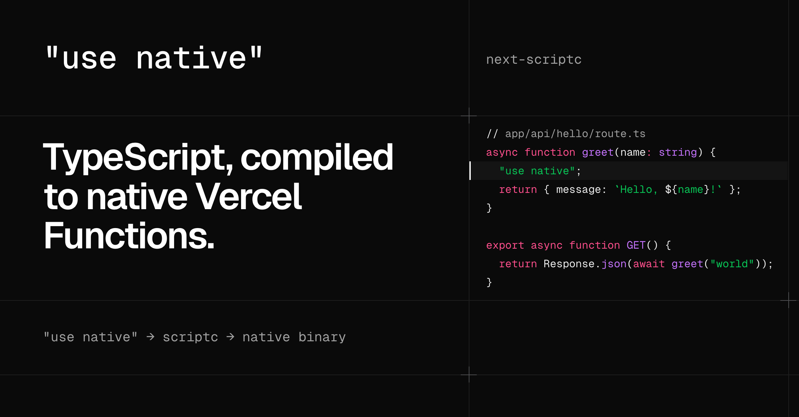
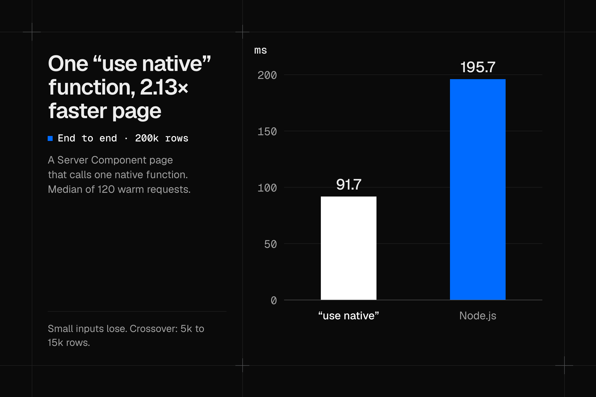

# next-scriptc

A Next.js adapter that compiles route handlers and server functions to native executables with [scriptc](https://github.com/vercel-labs/scriptc). It does not fork Next.js.



Experimental. Version `0.0.0`, not on npm. Tested with Next 16.4.3 and scriptc 0.4.6.

## Benchmarks

Native code pays off when a call does a lot of compute for a small payload. It loses on small calls, where the process boundary costs more than the work saves.

[](research/use-native-vercel.md#final-hosted-measurement-after-o1--o2)

| Vercel preview, iad1 | Node | Native |
| --- | ---: | ---: |
| `"use native"` page, 200k rows, end-to-end p50 | 195.7 ms | 91.7 ms |
| Same page, 5k rows, `"use native"` call time p50 | 3.8 ms | 4.3 ms |
| Markdown rendering with `marked`, process CPU per request | 4.6 ms | 40.2 ms |

The `"use native"` rows are warm requests from a client in iad1, 120 per row ([final hosted measurement](research/use-native-vercel.md#final-hosted-measurement-after-o1--o2)). The call crosses over between 5k and 15k rows. Each row is one workload, measured over short windows on a handful of previews. The table is not a claim about production capacity or billed CPU. In route experiments, Go also beat native TypeScript at CSV parsing and bcrypt. One vector-search route reached 10.0 ms of server compute against 14.2 ms for Go SIMD, but only with a patched scriptc compiler.

## Two ways to go native

- **`route.native.ts`** is an App Router route handler, compiled to a native HTTP server.
- **`"use native"`** marks an async function. The function is compiled, and calls cross a JSON boundary into a native process.

Everything else stays on Node. In `next dev`, both run as ordinary TypeScript on Node. Compilation happens in `next build`.

## Quickstart

You need Node 24, pnpm 11.1.3, and macOS or Linux with a native linker. See the [toolchain notes](examples/demo/README.md#compiler-installation).

In an existing Next 16.4.3 TypeScript app, install the adapter from this repository's Git subdirectory:

```sh
pnpm add "github:nebler/next-scriptc#path:/packages/next-scriptc"
pnpm approve-builds scriptc
pnpm rebuild scriptc
```

Keep optional dependencies enabled, and commit your lockfile to pin the Git revision.

Enable the adapter in `next.config.ts`:

```ts
import type { NextConfig } from "next";
import { withScriptc } from "next-scriptc";

const config: NextConfig = {};
export default withScriptc(config);
```

Create `app/api/hello/route.native.ts`:

```ts
export async function GET(request: Request) {
  const name = new URL(request.url).searchParams.get("name") ?? "world";
  return Response.json({ message: `Hello, ${name}` });
}
```

Build and start the app. `next start` launches and supervises the native processes.

```sh
pnpm exec next build
pnpm exec next start
# GET /api/hello?name=world returns {"message":"Hello, world"}
```

To try the full demo instead, clone this repository:

```sh
git clone https://github.com/nebler/next-scriptc.git
cd next-scriptc
pnpm install --frozen-lockfile
pnpm --filter demo dev
```

The [demo README](examples/demo/README.md) covers route grouping, the Node baseline, and compiler overrides.

## Native functions

Add `"use native"` as the first statement of a named, module-level async function:

```ts
// lib/totals.ts
export async function total(values: number[]): Promise<number> {
  "use native";
  return values.reduce((sum, value) => sum + value, 0);
}
```

Call it with `await total(values)` from a Server Component, Server Action, or route handler. A file-level `"use native"` selects every named exported async function in a non-route file. Route files reject file-level directives; use `route.native.ts` to compile the whole handler.

In production, arguments and results must be strict JSON. Optional fields, `undefined`, `any`, `unknown`, bigint, classes, functions, and cycles are rejected. Use a required `| null` field for absence. The [full constraints](research/function-level.md#extraction-and-constraints) cover what extraction rejects.

## Deploy to Vercel

Install and authenticate the Vercel CLI, then link and pull the project from your app directory:

```sh
vercel link
vercel pull --environment=preview
```

Build and deploy:

```sh
pnpm exec next-scriptc vercel-build
vercel deploy --prebuilt
```

`vercel-build` runs `vercel build` with Vercel's Next adapter, then replaces native routes with Linux x86-64 executable Functions. For function-level `"use native"`, it bundles a Linux sidecar into each Node Function. Calls reach the sidecar over loopback HTTP, and the first call can wait for the sidecar to start. Pass `--prod` to both commands for production. See [`"use native"` on Vercel](research/use-native-vercel.md) for measurements and limits.

## Limits

Limits that matter on day one:

- Native routes are a request bridge, not full Next.js. The [shim contract](packages/next-scriptc/shim/README.md) lists the supported `next/server` subset. There is no framework caching, uploads are buffered, and client aborts do not reach the handler.
- `output: "standalone"` and static export are unsupported when native routes or functions are configured.
- Whether an npm library compiles depends on scriptc. The compiler fails the build on code it refuses, and the [library outcomes](research/realistic-io.md#library-and-compiler-outcomes) list known cases.
- Native functions in one Node instance share a single native process and event loop, so CPU-heavy calls block each other.

Full evidence, including every measured loss, starts at the [research index](research/README.md). The main reports are:

- [Function-level results](research/function-level.md) and [`"use native"` on Vercel](research/use-native-vercel.md)
- [In-region client latency](research/vercel-near-client.md) and [final Vercel comparison](research/vercel-final.md)
- [Vector search](research/vector-vercel.md) and [where Go still wins](research/go-territory.md)

## How it works

The adapter uses Next's `adapterPath`, `modifyConfig`, and `onBuildComplete` hooks. It discovers native routes, generates typed entries, and compiles them with scriptc.

```text
Development:  Next -> original TypeScript on Node
Self-hosted:  Next -> loopback HTTP -> supervised native route process
              Node function stub -> JSON over loopback HTTP -> native functions
Vercel:       Vercel's Next adapter -> executable Function -> native HTTP + IPC
```

Each route gets its own native process by default. Routes in an explicit group share one process, its module state, and its failures. See the [adapter notes](research/adapter-notes.md).

## Develop and test

[](https://github.com/nebler/next-scriptc/actions/workflows/ci.yml)

```sh
pnpm install --frozen-lockfile
pnpm test  # compiler-free package tests and offline demo harness
```

CI runs only these compiler-free tests. [CONTRIBUTING.md](CONTRIBUTING.md) lists the native integration tests and what they need.

## License

[Apache-2.0](LICENSE), copyright next-scriptc contributors.
