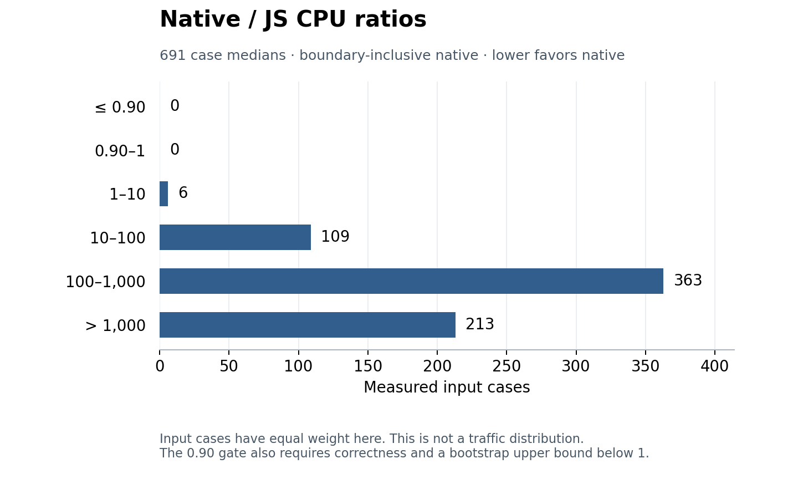

# M1: DEV accepted-function measurement

Measured 2026-11-03 on Apple M4 Pro, macOS arm64, Node 26.13.0 and unchanged
stock scriptc 0.4.6. **No supplied input demonstrated a native CPU saving.** Of
251 B1 discovery-accepted functions, 240 compiled and received exact-parity,
boundary-inclusive native measurements. The other 11 were compiler refusals.
Zero functions passed the frozen intensity screen; zero predicted a native lane;
zero passed the native CPU gate. Four intensity results remain unknown, not zero.

The evidence does **not** demonstrate that install-and-go automatic promotion saves
CPU on these real apps' accepted functions. It supports keeping these measured
calls in JS. It cannot rule out gains at unobserved production sizes or frequencies.
No endpoint harness ran, so endpoint CPU deltas remain null and the protocol's
≥5% endpoint saving gate is untested.

## Scope and evidence

The cohort is the exact 251 accepted functions from [B1](discovery-blockers-b1.md),
using its server scopes and [immutable DEV pins](eval-corpus/manifest.json), at
adapter baseline `6cfeb847000084a35683bb813483e4608e59560a`. It is the current-main
cohort at task start, before concurrent B1c discovery work. No discovery or
dispatcher policy was changed. This is not a new census or a population prevalence
estimate. B1's validator/file coverage gap remains unknown.

All 17 DEV pins were checked in fresh temporary checkouts; 15 Node repositories
installed dependencies with lifecycle scripts disabled. Fider and Maybe remain
non-Node controls without accepted functions or dependency installs. Installs
were serial, checked at least 12,000,000,000 free bytes before starting, reused
temporary caches, and removed app clones after use. No HELD_OUT repository or
Papermark was measured. No protected checkout, compiler fork, main node_modules,
root README, Docker, hosting API, or publication was involved.

| Repository | Accepted | Compiled | Screen pass | Predicted native |
| --- | ---: | ---: | ---: | ---: |
| toeverything/AFFiNE | 7 | 6 | 0 | 0 |
| actualbudget/actual | 2 | 2 | 0 | 0 |
| boardgameio/boardgame.io | 0 | 0 | 0 | 0 |
| lissy93/dashy | 0 | 0 | 0 | 0 |
| evidence-dev/evidence | 5 | 5 | 0 | 0 |
| excalidraw/excalidraw-room | 0 | 0 | 0 | 0 |
| getfider/fider | 0 | 0 | 0 | 0 |
| gristlabs/grist-core | 11 | 7 | 0 | 0 |
| growthbook/growthbook | 98 | 96 | 0 | 0 |
| linkwarden/linkwarden | 1 | 1 | 0 | 0 |
| maybe-finance/maybe | 0 | 0 | 0 | 0 |
| n8n-io/n8n | 53 | 51 | 0 | 0 |
| nocodb/nocodb | 8 | 8 | 0 | 0 |
| openpanel-dev/openpanel | 18 | 18 | 0 | 0 |
| PostHog/posthog | 38 | 37 | 0 | 0 |
| umami-software/umami | 3 | 3 | 0 | 0 |
| Unleash/unleash | 7 | 6 | 0 | 0 |

[Joined per-function observations](eval-corpus/dev-measure/functions.json.gz)
include compile status and attributed SC codes, verbatim batch compiler logs,
input provenance and arguments, JS/native CPU ns per call, input JSON bytes,
ns per byte, boundary share, lane prediction, raw pairs, cold costs and intervals.
[Summary](eval-corpus/dev-measure/summary.json),
[validation](eval-corpus/dev-measure/validation.json),
[environment](eval-corpus/dev-measure/environment.json), and
[reproduction instructions](eval-corpus/dev-measure/reproduce.md) accompany the
per-repository `results/` and `wall/` observations. Failed/pilot/stale attempts
are retained under `attempts/` and excluded from the final aggregate.

## Inputs and protocol

Inputs prefer literal calls found in test files, with local constant bindings,
`as const`, and shorthand objects resolved by the committed generator. The generator
retains numeric values, keys and shapes; it synthesizes string payloads while
preserving lengths, Unicode character widths and JSON structure. Schema literal
tags and source-checked prefixes/suffixes are restored. Original payloads exist
only temporarily; no third-party fixture file or source is committed.

Of 240 functions with native timings, 44 used test-shape-derived inputs, 190 used
type synthesis, five used synthetic fallback after unusable fixture tuples, and
one used a source-contract probe. Across 691 comparable input cases these are
106 test-shape-derived, 567 synthetic, 15 synthetic-fallback, and three
synthetic-source-contract cases. The extractor is name-based, not complete import
resolution; imported fixtures and executable builders can be missed. Derived
payloads do not preserve every domain correlation. This is realistic shape/size
evidence where available, not proof of representative production traffic.

Type-generated arrays/strings use 8, 32 and 128 elements/characters. Scalar
numbers stay 32, so scalar-only tuples can repeat; no arbitrary scalar loop bound
is inferred. Grist `isEmpty` needed valid permission-object inputs after unrelated
same-name array fixtures caused a native error. n8n `parseVersionDir` uses own
`v1`, `v2.3`, `v4.5.6` labels matching its decimal-component source contract;
arbitrary strings produced NaN and could not establish native parity. Both probes
are committed and supersede their earlier unsuitable tuples.

The [frozen protocol](eval-corpus/protocol.md) intensity screen uses **JS elapsed**
median ≥100,000 ns/call **and** ≥100 ns/input JSON byte. A separate JS-only pass
replays the same native arguments, with 30 warmups, a pilot, and 21 retained
batches of ≥2 ms (or the 10-million-iteration cap). It records both elapsed and
process CPU time, consumes results, and keeps input generation and serialization
outside compute timing. All 691 native cases have matching elapsed baselines. Final intensity fields in
the joined artifact come from this elapsed pass; older CPU-screen flags in raw
native observations are retained for provenance and are not the frozen screen.
247 functions have JS timings. The four unknown intensity results are Grist
`describeNode`, `getRecColIds`, `getChoiceColIds` (recursive synthesis budget), and
PostHog `sameWatcherStates` (unavailable bounded input type). All four are compiler
refusals. They do not count as screen failures or wins.

The research measurement child runs through `scriptc-promote report --measure`
and unchanged `buildPromotion`, using 30 warmups, two discarded cold pairs,
60 alternating JS/native process-CPU pairs per tuple, and 2,000 deterministic
circular block bootstrap resamples (block five, seed one). JS batch results are
consumed; native calls include owner-side validation/encoding, queue/scheduling,
worker computation and output decoding. Exact canonical JSON parity is checked
outside timed intervals, with no new numerical tolerance. All retained native
cases passed. The native gate is median native/JS CPU ≤0.90 and bootstrap 95%
upper bound <1.0, with zero correctness failures.

The unchanged `decideLane` policy is applied offline to the first 24 process-CPU
pairs (19 votes below 0.90 required). This is a process-CPU policy prediction,
not an observed live dispatcher decision: live selected-thread-clock training,
wrapper overhead, quotas, request frequencies and periodic rechecks are not
reproduced. Every prediction was independently recomputed from saved pairs.
Boundary share is a separate ten-call instrumented **wall-time** diagnostic,
not a decomposition of process CPU. Cold build time is shared per source batch;
first-call costs follow input preflight and are not whole-app cold starts.

## Ratios and closest leads

The distribution weights input cases equally, including repeated scalar tuples;
it does not weight by production requests. Native/JS process-CPU median ratios:
**minimum 1.35×; p10 49.60×; median 481.94×; p90 3,712.33×; maximum 542,357.96×**
(691 cases). A ratio above one means native consumed more CPU. Small helpers can
cost only a few JS nanoseconds while the boundary and worker cost tens of
microseconds. Cross-pass elapsed/CPU variability does not change the absence of
a paired native win.

The ten closest functions, selecting each function's lowest measured ratio,
are below. These are investigative leads, not successes. Numbers refer to that
same best-ratio case; source/size frequencies are unknown. Full intervals and
all other sizes remain in the joined artifact.

| Function (repository) | JS CPU ns | Native CPU ns | JSON bytes | Native/JS | Boundary wall share | Input source |
| --- | ---: | ---: | ---: | ---: | ---: | --- |
| `matchesRegistryQuery` (n8n-io/n8n) | 39,275.9 | 53,000.0 | 17,056 | 1.35× | 94.9% | synthetic |
| `getFlattenedUnitMetricsCTE` (growthbook/growthbook) | 1,268,250.0 | 4,542,000.0 | 2,149,965 | 3.58× | 84.4% | synthetic |
| `getSurrogateKeysFromEnvironments` (growthbook/growthbook) | 24,117.6 | 115,000.0 | 16,902 | 4.77× | 95.2% | synthetic |
| `rewriteProfilePropertyRefs` (openpanel-dev/openpanel) | 15,876.0 | 97,000.0 | 16,902 | 6.11× | 81.5% | synthetic |
| `adjustWeights` (growthbook/growthbook) | 8,424.9 | 86,000.0 | 387 | 10.21× | 94.2% | synthetic |
| `hash64` (nocodb/nocodb) | 3,162.9 | 43,000.0 | 132 | 13.60× | 75.1% | synthetic |
| `listEntries` (growthbook/growthbook) | 10,625.0 | 157,000.0 | 19,075 | 14.78× | 92.4% | synthetic |
| `gitHubTreeUrl` (n8n-io/n8n) | 1,267.6 | 21,000.0 | 525 | 16.57× | 89.0% | synthetic |
| `combineExpr` (gristlabs/grist-core) | 7,131.0 | 120,000.0 | 16,902 | 16.83× | 93.1% | synthetic |
| `describeCollisions` (openpanel-dev/openpanel) | 414,000.0 | 7,033,000.0 | 2,165,891 | 16.99× | 97.7% | synthetic |

Every lead fails the intensity screen and predicts JS. No case has even a point
ratio ≤0.90, so the worker's winner-only `--trace-deopt` / remainder-operation
cliff audit was never triggered (zero audits). These results make **no claim of
cliff-free JS baselines**. Any future native winner must first receive the
[D1b baseline audit](shared-native-remeasure.md), including steady deopt loops,
floating `%` and comparison against an appropriate JS implementation, before
being presented as a win. There is no strawman native win in this dataset.

B1's NocoDB compute leads also lose at the tested synthetic array sizes:

- `packages/nocodb-sdk/src/lib/aggregationCompute.ts#minOf`: JS 9.9, 18.6, 63.3 ns; native 57,000, 65,000, 99,000 ns at 8/32/128 elements.

- `packages/nocodb-sdk/src/lib/aggregationCompute.ts#maxOf`: JS 10.1, 19.0, 64.3 ns; native 110,000, 100,000, 110,000 ns at 8/32/128 elements.

The closest lead, n8n `matchesRegistryQuery`, has B1's conservative route graph
available in `b1RouteEntries` in the joined artifact, as do all functions. Static
identifier-reference reachability is not frequency or endpoint attribution. With
no winners, no endpoint saving estimate is justified; all endpoint deltas stay
null.

## Compiler refusals and report repairs

Eleven accepted functions are stock compiler refusals: AFFiNE permission mapping
(SC2020); Grist permission summarization (SC4003) and three predicate helpers
(SC2009, inherited SC2004); GrowthBook aspect-ratio snapping (SC4003) and warehouse
regions (SC0001); n8n's two onboarding-answer helpers (SC2020); PostHog watcher
states (SC0001, unresolved `HogWatcherState`); Unleash combinations (SC2020).
Codes are attributed to the relevant function's batch-log section; complete
original diagnostics remain available. Discovery acceptance alone is not stock
compiler acceptance.

Measurement exposed two report isolation bugs, fixed minimally with regressions:
a failing tuple previously suppressed later tuples, and a fatal native VM error
poisoned a shared addon, contaminating later inputs/functions. Report now catches
per tuple and loads a unique native-library instance per tuple. A test supplies
an unsupported array then a valid object to the same helper: it reproduced the
poisoned-instance failure before the fix and passes afterward. This does not
establish a compiler bug on valid Grist permission objects. The frozen research
collector uses per-function instances; the valid-object supplement closes its
only affected retained function, and all 240 compiled functions have successful
comparisons. Neither discovery nor dispatcher was edited.

Final suites: `packages/next-scriptc` **103 pass**, `packages/scriptc-promote`
**111 pass, two existing skips**, zero failures. Logs and source fingerprints are
under `validation/`, including the red/green isolation regression. The
input-generation/native integration self-check also
passed. Artifact validation verifies the exact cohort and pins, install floor,
raw sample counts, gates, argument joins, lane votes and null endpoint deltas.
Compression, research-link and whitespace checks are recorded with the final
artifacts. Reproduction retains failed attempts separately instead of converting
resource failures or invalid inputs into performance evidence.

Task-owned temporary clones, dependency caches, tools and source probes were
removed after preserving results; [cleanup record](eval-corpus/dev-measure/cleanup.json).
